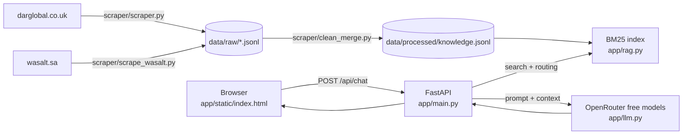

# DarGlobal AI Chatbot

A bilingual (English / Arabic) question-answering chatbot for **DarGlobal** (London-listed luxury real estate developer) and **Wasalt** (Saudi real estate platform). It answers only from data scraped from their public websites and cites the page behind every fact.

Built by **Mohammed Abdul Moid** as part of a technical assessment. Contact: 10abdulmoid@gmail.com

> Unofficial demo. Not affiliated with DarGlobal or Wasalt. The knowledge base is a snapshot taken on **19 Nov 2026**.

---

## Features

- **Answers with citations.** Every fact carries an inline `[n]` that links to its source page. Sources show as cards under the answer.
- **Retrieval-augmented generation (RAG).** BM25 keyword search over about 3,200 text chunks picks the context. The model is told to use only that context and to say so when the answer isn't there.
- **Scope toggle.** Search **All**, **DarGlobal** only, or **Wasalt** only.
- **English and Arabic.** One click switches the whole interface to right-to-left Arabic.
  - Arabic questions are translated to English for the search step, then answered in Arabic.
  - An Arabic keyword map keeps search working if that translation failss.
- **Guardrails** in the system prompt:
  - no investment, legal or financial advice
  - no personal data beyond a person's public role
  - stays on topic and ignores prompt-injection attempts
  - never claims to represent either company
  - answers "No" directly when a complete list in the data rules something out
- **Free models with automatic fallback.** It picks currently available `:free` models on OpenRouter and moves to the next one on a rate limit, an error or an empty reply.
- **Saved chats.** Chats are stored in the browser (localStorage): a **Recent** panel, and the open chat is restored on reload. No database, no cookies.
- **Answer cache.** Repeated standalone questions are answered from server memory for 24h, without another model call.
- **Polished UI.** A single static HTML file with no framework and no build step:
  - status words while waiting, then a typewriter reveal of the answer
  - dark mode and responsive phone layout
  - respects reduced-motion settings
- **Evaluation harness** (`eval/`) measuring retrieval accuracy, guardrails and speed.

## How it works



1. **Scrape.** The scrapers read each site's `robots.txt` and sitemaps, fetch pages (re-rendering JavaScript-heavy pages in a browser), and extract the main text.
2. **Clean and chunk.** `clean_merge.py` drops duplicates and site-wide boilerplate, caps huge pages, and splits text into chunks of about 1,200 characters.
3. **Retrieve.** For each question, `rag.py`:
   - expands it with synonyms
   - routes it to DarGlobal, Wasalt or both
   - weights results by page type (company pages and FAQs above blog posts; listings for property searches)
   - keeps at most 2 chunks per page, and returns the top 6
4. **Generate.** `main.py` numbers the chunks as CONTEXT and adds the system rules and the last 3 exchanges. `llm.py` calls a free model. Only the sources the answer actually cites are returned.

### Why no LangChain or vector database?

The pipeline is about 300 lines of plain Python. BM25 needs no GPU, no embedding model download and no vector store, so the Docker image stays small and starts fast on free hosting. Every step is easy to read and debug. Embeddings, reranking or an agent framework would be the next step if the data or requirements grew.

## Repository layout

```
app/
  main.py            FastAPI app: /api/chat, /health, system prompt, guardrails, answer cache, timing
  rag.py             BM25 index, company routing, page-type weighting, synonyms (incl. Arabic keywords)
  llm.py             OpenRouter client: free-model discovery, ranking, fallback, cooldowns
  static/index.html  The whole frontend (HTML + CSS + vanilla JS)
  static/darglobal-logo.png
  requirements.txt
scraper/
  scraper.py         DarGlobal scraper
  scrape_wasalt.py   Wasalt scraper
  retry_missing.py   Re-fetch pages the first DarGlobal pass missed, using a real browser
  clean_merge.py     Clean, dedupe and chunk raw data -> data/processed/knowledge.jsonl
data/
  raw/               Scraped pages (JSONL)
  processed/knowledge.jsonl   The chatbot's knowledge base (~3,200 chunks)
eval/
  testset.json       25 retrieval + 10 guardrail questions (expected pages verified)
  run_eval.py        Evaluation script
  results.md/.json   Latest results
Dockerfile, .dockerignore
```

## Quick start (local)

Requirements: Python 3.11+ and a free [OpenRouter](https://openrouter.ai) API key.

```bash
git clone https://github.com/10abdulmoid/darglobal-chatbot.git
cd darglobal-chatbot
python -m venv .venv
.venv\Scripts\activate            # Windows  (macOS/Linux: source .venv/bin/activate)
pip install -r app/requirements.txt
```

Create a `.env` file in the repo root:

```
OPENROUTER_API_KEY=sk-or-...
```

Run the server from inside `app/`:

```bash
cd app
python -m uvicorn main:app --port 7860 --reload
```

Open http://localhost:7860. `--reload` picks up Python changes automatically. Changes to `index.html` only need a browser refresh.

## Docker

```bash
docker build -t property-assistant .
docker run -p 7860:7860 --env-file .env property-assistant
```

The image contains only `app/` and `data/processed/knowledge.jsonl`, with no scrapers and no raw HTML. It runs as user 1000 on port 7860, so it also works as a **Hugging Face Docker Space**: add `OPENROUTER_API_KEY` as a Space secret.

## Configuration

| Variable | Default | Purpose |
|---|---|---|
| `OPENROUTER_API_KEY` | – (required) | OpenRouter key |
| `OPENROUTER_MODELS` | auto | Comma-separated model IDs; overrides automatic free-model selection |
| `OPENROUTER_BASE_URL` | `https://openrouter.ai/api/v1` | API base URL |
| `KNOWLEDGE_FILE` | `data/processed/knowledge.jsonl` | Path to the knowledge base |
| `APP_URL` | HF Spaces URL | Sent to OpenRouter as `HTTP-Referer` |
| `PORT` | `7860` | Port used by the Docker image |

## API

**`POST /api/chat`**

```json
{
  "messages": [{"role": "user", "content": "Who is the CEO of DarGlobal?"}],
  "company": "all",
  "lang": "en"
}
```

- `company`: `all` | `darglobal` | `wasalt`. Optional, default `all`.
- `lang`: `en` | `ar`. Optional, default `en`.

Response:

```json
{
  "answer": "Ziad El Chaar is DarGlobal's Founder and CEO [1].",
  "sources": [{"n": 1, "title": "About Us", "url": "https://darglobal.co.uk/about", "source": "darglobal"}],
  "model": "provider/model:free",
  "timing": {"retrieval_ms": 14, "llm_ms": 2310, "total_ms": 2330, "cached": false}
}
```

If every model fails, it returns HTTP 503 with `"error": true` and a friendly message.

**`GET /health`** returns the chunk count, sources, the models in use, whether the key is set, and the answer-cache size.

## Refreshing the data

```bash
pip install -r scraper/requirements.txt
pip install playwright && playwright install chromium   # optional: for JavaScript-rendered pages

python scraper/scraper.py              # DarGlobal  -> data/raw/darglobal.jsonl
python scraper/retry_missing.py        # optional: re-fetch missed pages in Edge/Chrome
python scraper/scrape_wasalt.py        # Wasalt     -> data/raw/wasalt.jsonl
python scraper/clean_merge.py          # -> data/processed/knowledge.jsonl
```

Then update `DATA_DATE` near the top of the script in `app/static/index.html`. It sets the "Knowledge updated as of …" line.

## Evaluation

```bash
python eval/run_eval.py --base-url http://localhost:7860   # needs the server running
python eval/run_eval.py --skip-api                          # retrieval only, no server or LLM
```

- **Retrieval** (no LLM): checks whether each question's verified source page is ranked by `Index.search()`, and reports hit@1/3/6 and MRR overall and per category.
- **Guardrails:** 10 adversarial questions (investment advice, personal data, code requests, prompt injection, share price, "projects in India?"). Each is scored by simple, documented rules, and every answer is saved for human review.
- **Speed:** p50/p95 of the server's `retrieval_ms`, `llm_ms` and `total_ms`, plus the error rate and which models answered.

Latest retrieval result (25 questions): **hit@1 68% · hit@3 80% · hit@6 88% · MRR 0.74**.

- Company facts, results and Wasalt company and listing questions all scored 100% at hit@1.
- Partner pages scored lowest. That's partly because the same facts also appear on project pages and press releases.

The guardrail and speed sections in the committed `results.md` are empty: that run hit the free tier's daily request limit. Re-run once the quota resets.

## Known limitations

- **Free-tier quota.** OpenRouter's free tier allows 50 model requests per day. Fallback attempts and Arabic translation calls also count against it. For a real deployment, add credits (1,000 free-model requests a day) or use a paid model.
- **Keyword search.** BM25 matches words, not meaning. Generic words can outrank the one that matters; for example, "properties in Spain" doesn't surface the Spain page. Embeddings or a reranker would help.
- **Static snapshot.** Prices, listings and news reflect the scrape date, not live data.
- **Browser-only chat history.** Chats don't sync across devices, and clearing browser data deletes them.

## Disclaimer

This is an independent, unofficial demo built for a technical assessment. All content comes from the public websites darglobal.co.uk and wasalt.sa and may be out of date. DarGlobal and Wasalt names and logos belong to their respective owners.
